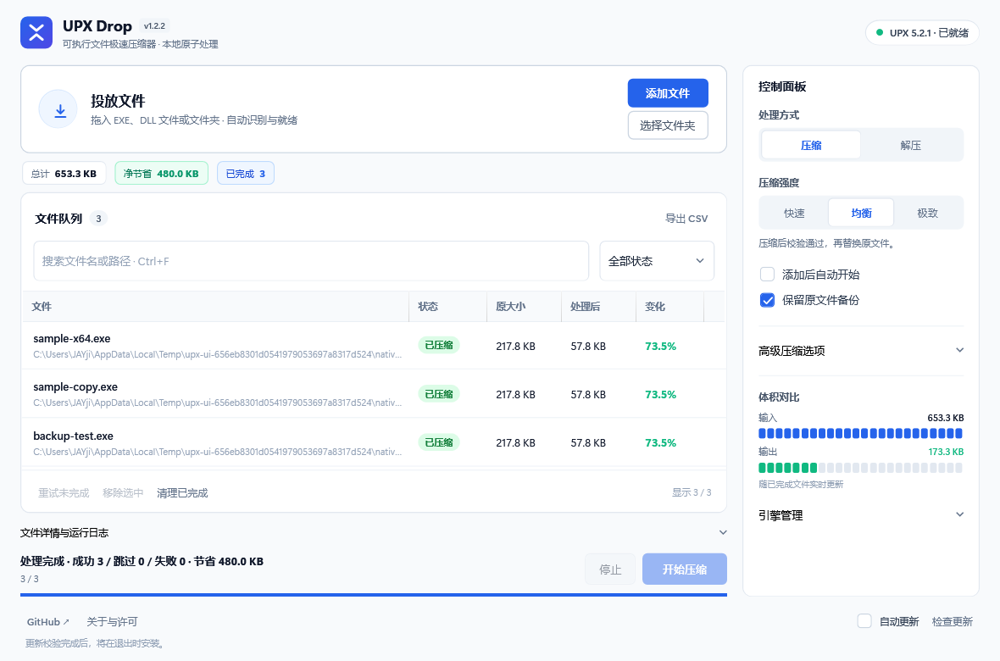
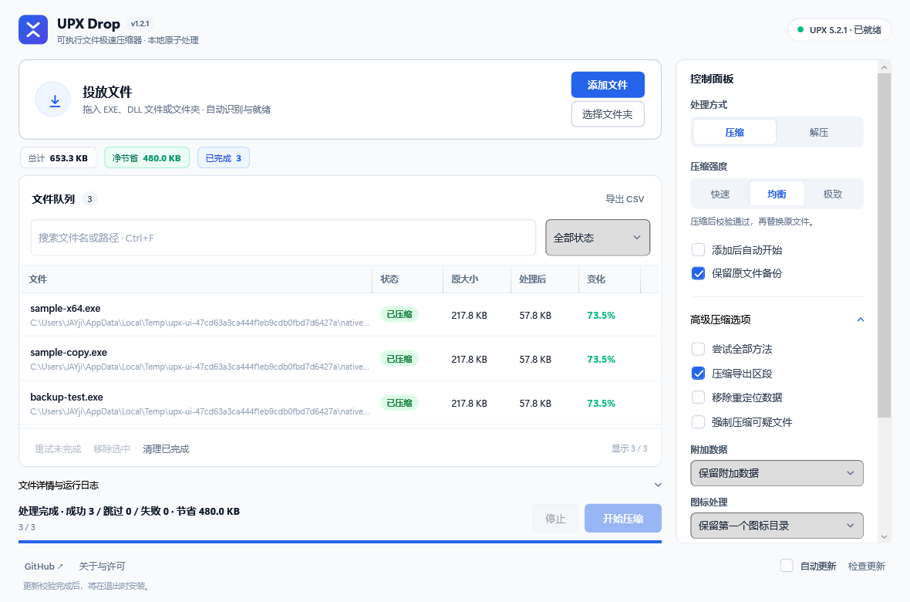

<div align="center">


# UPX Drop

**Windows EXE / DLL 批量压缩与解压**

一个 EXE，拖入文件就能用。内嵌官方 UPX 5.2.1。

[**下载 Windows 版**](https://github.com/Jay1023CN/upx-drop/releases/latest/download/UpxDrop.exe)　·　[版本记录](https://github.com/Jay1023CN/upx-drop/releases)　·　[反馈问题](https://github.com/Jay1023CN/upx-drop/issues)

[](https://github.com/Jay1023CN/upx-drop/actions/workflows/build.yml)

</div>



<p align="center"><sub>1.2.2 界面 · 图中为官方 UPX 处理原生测试程序的实际结果，压缩率取决于文件本身。</sub></p>

---

## 它能做什么

UPX Drop 用来缩小 Windows EXE 和 DLL 文件的体积，把 UPX 命令行做成了可直接操作的图形界面。拖入文件、选择压缩强度，就能批量处理，适合开发者在发布软件前给程序瘦身。

| 功能 | 使用方式 |
| :--- | :--- |
| **批量压缩与解压** | 添加文件或拖入整个文件夹，自动扫描子目录、去除重复项；也能解压 UPX 压缩过的文件。 |
| **三档压缩强度** | 快速、均衡、极致，按处理速度和体积需求选择，默认使用均衡。 |
| **队列管理** | 自动或手动开始，处理中可继续追加文件、停止任务；失败或取消的文件可以重试。一次最多加入 5000 个文件。 |
| **搜索与状态筛选** | 按文件名、路径或处理状态查找，支持多选移出队列、清理已完成记录。 |
| **结果统计与导出** | 查看每个文件处理前后的大小、变化比例和详细日志，统计整个队列节省的空间；处理记录可导出为 Excel 能打开的 CSV。 |
| **原文件保护** | 先处理临时副本，压缩校验通过后再替换；失败或取消时保留原文件。自动跳过带数字签名、压缩后没有变小的文件，也可开启原文件备份。 |
| **高级压缩设置** | 调整图标、附加数据、导出区段和重定位数据的处理方式，或尝试全部压缩方法。 |
| **自动更新** | 检查 GitHub 上的新版本，下载并校验后，在退出时完成更新。 |

文件处理全在本地完成，不上传文件。实际能缩小多少取决于程序本身；压缩校验通过后，发布前仍需要运行原程序确认功能正常。

## 开始使用

1. 下载 [UpxDrop.exe](https://github.com/Jay1023CN/upx-drop/releases/latest/download/UpxDrop.exe)，直接运行。
2. 选择压缩或解压，按需开启“保留原文件备份”。
3. 拖入 EXE、DLL 或文件夹。默认自动开始，也可以关闭自动开始后手动处理。

适用于 **Windows 10 / 11 x64**，需要 **.NET Framework 4.8**。无需安装包，也无需在 EXE 旁附带 DLL、配置或 UPX 文件。首次启动会校验并释放内嵌引擎，之后可离线处理文件。

| 快捷键 | 操作 |
| --- | --- |
| `Ctrl+O` | 添加文件 |
| `Ctrl+F` | 搜索文件名或路径 |
| `Delete` | 移除选中项，磁盘文件保留 |
| 双击文件行 | 在资源管理器中定位 |

## 队列操作

| 功能 | 行为 |
| --- | --- |
| 后台扫描 | 递归扫描文件夹，跳过文件与目录链接，自动去重。队列最多 5000 个文件；扫描可取消。 |
| 搜索与筛选 | 按文件名、完整路径或状态筛选。筛选只改变显示，不影响整个待处理队列。 |
| 重试未完成 | 重新处理失败和已取消的文件，使用当前设置，不重复处理已成功文件。 |
| 移除选中 | 支持多选，只移出队列，不删除磁盘文件。 |
| 清理已完成 | 清理已压缩、已解压和已跳过的记录，保留失败及取消项。 |
| 导出 CSV | 导出整个队列，包括隐藏项的路径、操作、状态、前后字节数、变化比例和日志。 |

进度按文件数计算；体积与完成数量按整个队列统计。解压后体积增大时显示“净增加”。CSV 使用带 BOM 的 UTF-8 编码，可直接用 Excel 打开中文内容。

## 压缩与原文件保护

默认使用均衡压缩 `-7`，还可选快速 `-1`、极致 `--best` 和解压 `-d`。

每个文件先在同目录创建临时副本，完成 UPX 压缩及 `upx -t` 校验后，再核对原文件是否变化，最后原子替换。失败或取消保留原文件；已完成项不随取消回滚。带数字签名的文件自动跳过，压缩后没有变小也保留原文件。

<details>
<summary><b>高级选项与备份说明</b></summary>

- 创建备份：默认关闭；开启后，成功替换时，在原文件旁生成独立命名的 `.upxdrop-<随机值>.bak`，不覆盖历史备份。需要还原时，关闭占用文件的程序，将备份复制回原文件名。
- 尝试全部压缩方法：`--all-methods`，耗时较长。
- 压缩导出区段；重定位数据默认保留，以兼容启用 ASLR 的现代 EXE 和 DLL。可选择为兼容的非 ASLR EXE 移除重定位；不会自动关闭 ASLR。
- 强制压缩可疑文件：`--force`，默认关闭，可能影响程序兼容性；签名文件仍然跳过。
- 附加数据：保留、丢弃或跳过含附加数据的文件。官方 UPX 没有单独压缩附加数据的选项；丢弃后不能靠解压恢复。
- 图标：不压缩、保留第一个图标、保留第一个图标目录或压缩全部。

不修改 UPX 标志，以保持官方格式、校验和解压能力；不提供旧版 UPX 切换。压缩流程为：同目录临时副本 → UPX → `upx -t` → 核对原文件未变化 → 原子替换。失败或取消保留原文件；已完成的文件不随取消回滚。UPX 校验不能代替原程序的功能测试。


</details>

<details>
<summary><b>自动更新与运行目录</b></summary>

默认启动时通过 GitHub API 检查本仓库最新正式 Release。只接受更高的 `v主.次.修订` 版本、名为 `UpxDrop.exe` 的附件和对应 SHA-256；忽略草稿、预发布版和旧版本。优先使用 GitHub 提供的附件 digest，否则使用同一 Release 的 `UpxDrop.exe.sha256`。没有 Release、离线或校验失败均不会替换当前程序。

下载并校验完成后，底部显示版本，按钮变为“退出并更新”。正常退出后，由 Windows PowerShell 等待主进程结束，重新验证并原子替换 EXE，然后重启。安装目录必须对当前用户可写，不请求管理员权限。安装异常会尝试恢复旧版，并记录到 `%LOCALAPPDATA%\UpxDrop\updates\last-update.log`。GitHub 仓库和 Release 发布权限是更新的信任来源；SHA-256 不是独立的代码签名。

可关闭“自动更新”，或使用 `UpxDrop.exe --no-update-check` 本次离线启动。更新状态不会覆盖压缩队列日志。运行时联网只用于检查/下载版本；不会上传待处理文件。


引擎缓存位于 `%LOCALAPPDATA%\UpxDrop\engine`，用户设置和更新缓存也位于 `%LOCALAPPDATA%\UpxDrop`。单文件分发不代表运行时不产生缓存。

</details>

<details>
<summary><b>展开高级设置界面</b></summary>



</details>

## Windows 构建、测试和发布

无需 Node.js、Python、SDK 或 NuGet 包。使用 Windows 自带的 .NET Framework 4.8 编译器和 Windows PowerShell：

```powershell
powershell -ExecutionPolicy Bypass -File .\build.ps1 -Test
powershell -ExecutionPolicy Bypass -File .\package.ps1
```

构建脚本在需要时从 UPX 官方 Release 下载固定版本，并验证仓库固定的 SHA-256。应用输出：`dist/UpxDrop/UpxDrop.exe`。打包输出：

- `outputs/UpxDrop.exe`：唯一需要分发给最终用户的程序。
- `outputs/UpxDrop.exe.sha256`：自动更新校验附件。
- `outputs/UpxDrop-1.2.2-source.zip`：应用完整源码、构建脚本和 UPX 对应完整源码归档；与 EXE 在同一 Release 发布，运行程序不依赖它。

现有核心测试使用本地 fixture 子进程，覆盖备份、取消、原文件保护、签名检测和选项传递，不等同于真实 UPX 对所有软件的兼容性验证。另有更新元数据/完整性测试、内嵌引擎释放与缓存修复测试、两种窗口大小的 XAML 渲染检查，以及隔离目录只放一个 EXE 的离线启动检查。Windows 更新测试使用独立的旧/新 EXE fixture，验证退出后替换与重启、含中文/空格/单引号的路径，以及新 EXE 无法启动时还原旧程序。压缩文件备份默认关闭；自更新回滚仅在更新安装期间临时保留旧程序，两者相互独立。

可选的 `test-native.ps1` 使用 Visual C++ 开发者命令行或 PATH 中的 MinGW GCC 编译原生 PE fixture，使用内嵌官方 Windows UPX 验证实际压缩、解压、备份和压缩后程序行为；它不影响普通应用构建所需的依赖。

Windows CI 会运行上述真实引擎检查、构建、测试和上传 EXE、校验文件、源码包及界面截图。发布新版本时，同时修改 `src/Updater.cs` 的 `CurrentVersion` 和 `src/AssemblyInfo.cs` 的版本，然后推送匹配的版本标签（例如 `v1.2.0`）；CI 通过后自动创建正式 GitHub Release。普通分支推送仅生成构建产物，不发布版本。

新增队列测试覆盖扫描去重、容量限制、取消、搜索和 CSV 转义；WPF 交互测试覆盖重试、筛选、移除、模式切换、处理中追加文件与取消扫描。新增交互测试使用隔离的设置目录，不覆盖日常配置。

界面接入约定见 [UI-INTEGRATION.md](docs/UI-INTEGRATION.md)。

## 开源与许可

Copyright (C) 2026 Jay1023CN and contributors. GPL-2.0-or-later，见 [LICENSE](LICENSE)。项目地址：https://github.com/Jay1023CN/upx-drop ，界面底部也可打开该地址及许可文本。

程序内嵌并运行未修改的官方 UPX。原始许可见 [tools/UPX-LICENSE](tools/UPX-LICENSE) 和 [THIRD_PARTY_NOTICES.md](THIRD_PARTY_NOTICES.md)。每次发布同时提供对应源码包；许可和源码归档无需放在用户 EXE 旁才能运行。
