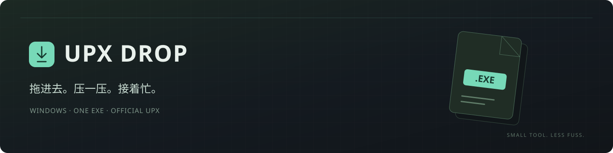

<div align="center">
  
  <br /><br />
  <a href="https://github.com/Jay1023CN/upx-drop/releases/latest"></a>
  <a href="https://github.com/Jay1023CN/upx-drop/actions/workflows/build.yml"></a>
  <a href="LICENSE"></a>
  <p><a href="#use">先用起来</a> &nbsp; / &nbsp; <a href="#features">能做什么</a> &nbsp; / &nbsp; <a href="#build">自己编译</a> &nbsp; / &nbsp; <a href="docs/CHANGELOG.md">更新记录</a></p>
</div>

我想做的事情其实挺简单：把 EXE 或 DLL 拖进来，压一下，然后接着忙自己的事。

所以有了 UPX Drop。官方 UPX 放在软件里面，下载一个 EXE 就能用。文件在本地处理，批量拖进来也会一个个排好队。至于压缩强度、图标、备份这些，想调的时候，右边就有。

<!-- app-screenshot -->

<a id="use"></a>
## 先用起来

<div align="center">
  <h3><a href="https://github.com/Jay1023CN/upx-drop/releases/latest/download/UpxDrop.exe">↓ 下载 UpxDrop.exe</a></h3>
  <p><sub>Windows 10 / 11 · .NET Framework 4.8 · 当前版本 1.1.1</sub></p>
</div>

双击打开，把 EXE、DLL 或整个文件夹拖进去。默认是均衡压缩，添加后自动开始；想先把队列整理好，就把“添加后自动开始”关掉。

**默认直接覆盖原文件，不生成备份。** 需要保留一份原件，在右侧勾选“创建原文件备份”就行。压缩失败、校验不通过或中途取消时，本次处理的原文件会留在原处；之前已经成功的文件不会跟着回滚。

用着用着发现某个文件失败了，或者刚才手快点了停止，也不用把队列清掉重来。“重试失败项”会把失败、取消的文件重新排队，已经成功的那些就不再动了。

> 分发时只需要这一个 EXE。运行时，内嵌 UPX 会自动释放到当前用户的缓存目录，设置也保存在用户目录；不需要把这些缓存文件放到程序旁边。较旧的 Windows 10 如果没有 .NET Framework 4.8，需要先安装微软的运行库。

<a id="features"></a>
## 能做什么

<table>
  <tr>
    <td width="33%" valign="top"><h3>拖进去，排好队</h3><p>EXE、DLL、文件夹都可以。队列能看进度，处理日志能看具体原因，失败的文件可以单独重试。</p></td>
    <td width="33%" valign="top"><h3>想省事，也能细调</h3><p>默认均衡压缩。需要时再选速度、体积、图标、导出区段、附加数据和文件备份。</p></td>
    <td width="33%" valign="top"><h3>该更新时，提醒你</h3><p>从这个仓库的正式 Release 检查新版。下载后校验，退出软件再替换；也可以关掉自动更新。</p></td>
  </tr>
</table>

| 选项 | 实际会做什么 |
| --- | --- |
| 压缩 / 解压 | 支持官方 UPX 的压缩和解压；解压模式会禁用只对压缩生效的设置。 |
| 压缩强度 | 快速 `-1`、均衡 `-7`、最大压缩 `--best`。 |
| 尝试全部方法 | 使用 `--all-methods`。体积想再挤一挤，可以试，但确实会慢。 |
| 文件备份 | 默认关闭。开启后，在原文件旁保存单独命名的 `.bak`，不会覆盖上一次备份。 |
| 图标 | 不压缩、保留第一个图标、保留第一个图标目录，或者全部压缩。 |
| 附加数据 | 保留、丢弃，或跳过这类文件。丢掉的数据不能靠解压找回来。 |
| 重定位 | 默认保留，兼容启用 ASLR 的现代程序。可为兼容的非 ASLR EXE 选择移除，不会自动关闭 ASLR。 |
| 强制压缩 | 默认关闭。适合知道自己在处理什么的情况，建议保留原件再试。 |

有几件事，我也想提前说清楚：

- **不是所有 EXE 都能压。** 官方 UPX 暂不支持 .NET 程序，一些特殊格式也会拒绝处理。软件会把原因放进日志，不会为了显示“成功”强行改文件。
- 有数字签名的文件会跳过。修改这类文件会破坏签名，强制选项也不会绕过这里的判断。
- 仍然保留官方 UPX 标志和文件格式，方便校验、解压；没有加入破坏标志的功能。
- 文件夹会递归扫描，跳过目录链接，每批最多 5000 个文件。中文、空格路径会用真实 Windows UPX 做集成测试。
- UPX 校验通过，只代表压缩结果通过了它的校验。你自己的程序，压完还是要自己打开跑一跑。

<details>
<summary><b>想知道它怎么写回原文件？</b></summary>

处理顺序是：同目录临时副本 → 官方 UPX → `upx -t` 校验 → 检查原文件是否被改动 → 原子替换。

原文件在处理期间被其他程序修改了，就取消替换。取消任务时会清理临时文件；如果直接断电或强杀进程，可能留下 `.upxdrop-*` 临时文件。文件备份是可选的；软件自更新时用于失败恢复的临时旧 EXE，是另外一回事。

</details>

<details>
<summary><b>自动更新具体怎么更新？</b></summary>

启动时检查本仓库的最新正式 Release，只接受更高版本的 `UpxDrop.exe`。草稿、预发布版和旧版本都不会装。优先使用 GitHub 附件的 SHA-256 digest，否则读取同一 Release 的 `UpxDrop.exe.sha256`。

下载、校验完成后，界面会显示版本，按钮变成“退出并更新”。正常退出时，由 Windows PowerShell 等待主进程结束，再替换 EXE 并重启。安装目录需要对当前用户可写，不请求管理员权限。

离线、下载超时、校验失败时继续用当前版本。替换后的程序无法启动，会尝试恢复旧程序；故障记录在 `%LOCALAPPDATA%\UpxDrop\updates\last-update.log`。SHA-256 用来检查完整性，仓库和 Release 的发布权限仍然是更新的信任来源。

可以关闭“自动更新”，也可以用 `UpxDrop.exe --no-update-check` 本次离线启动。联网用于检查、下载版本，不上传你拖进去的文件。

</details>

<a id="build"></a>
## 我也想自己改一改

源码、测试、构建脚本都在这里。普通构建需要 Windows 的 .NET Framework 4.8 编译器和 Windows PowerShell。

```powershell
# 构建，并运行现有测试
powershell -ExecutionPolicy Bypass -File .\build.ps1 -Test

# 生成单 EXE、更新校验文件和对应源码包
powershell -ExecutionPolicy Bypass -File .\package.ps1
```

程序在 `dist/UpxDrop/UpxDrop.exe`，发布文件在 `outputs/`。每个正式 Release 会一起提供 EXE、SHA-256 和源码 ZIP；源码包包含应用代码、构建脚本，以及官方 UPX 对应的完整源码归档。**源码包用于开源和再分发，不是运行依赖。**

<details>
<summary><b>测试和发布的细节</b></summary>

Windows CI 会编译程序、运行核心逻辑和更新校验测试，并执行以下实际检查：

- 空队列、失败重试、进度和压缩 / 解压控件状态。
- 两种窗口尺寸、空列表和带文件的界面渲染。
- 一个目录里只放 EXE，离线启动。
- 真实官方 Windows UPX 压缩、解压原生 PE，核对备份、程序行为和 ASLR。
- 软件自更新替换、重启，以及新程序启动失败后还原旧程序。

真实原生 PE 检查使用 `test-native.ps1`，需要 Visual C++ 开发者命令行。它是 CI 的集成检查，不影响普通应用构建所需的依赖。Linux 下可以运行部分核心测试和交叉编译，Windows 的实际结果仍以对应提交的 CI 为准。

发布新版本时，同时更新 `src/Updater.cs` 的 `CurrentVersion`、`src/AssemblyInfo.cs` 和 `app.manifest` 的版本，推送匹配标签。标签 CI 通过后，自动创建正式 Release。普通分支推送只生成构建产物，不会发布正式版。

</details>

## 引擎与许可

UPX Drop 使用**未修改的官方 UPX 5.2.1**。固定下载版本并核对 SHA-256；官方出处、原始许可和对应源码信息见 [THIRD_PARTY_NOTICES.md](THIRD_PARTY_NOTICES.md) 与 [tools/UPX-LICENSE](tools/UPX-LICENSE)。项目是独立前端，与 UPX 官方没有隶属关系。

应用采用 [GPL-2.0-or-later](LICENSE)。界面里的“关于与许可”也能查看协议和项目地址。

---

<div align="center"><sub>有问题就提 <a href="https://github.com/Jay1023CN/upx-drop/issues">Issue</a>，说清楚在哪一步卡住就好。压缩完了，记得打开自己的程序跑一跑。</sub></div>
